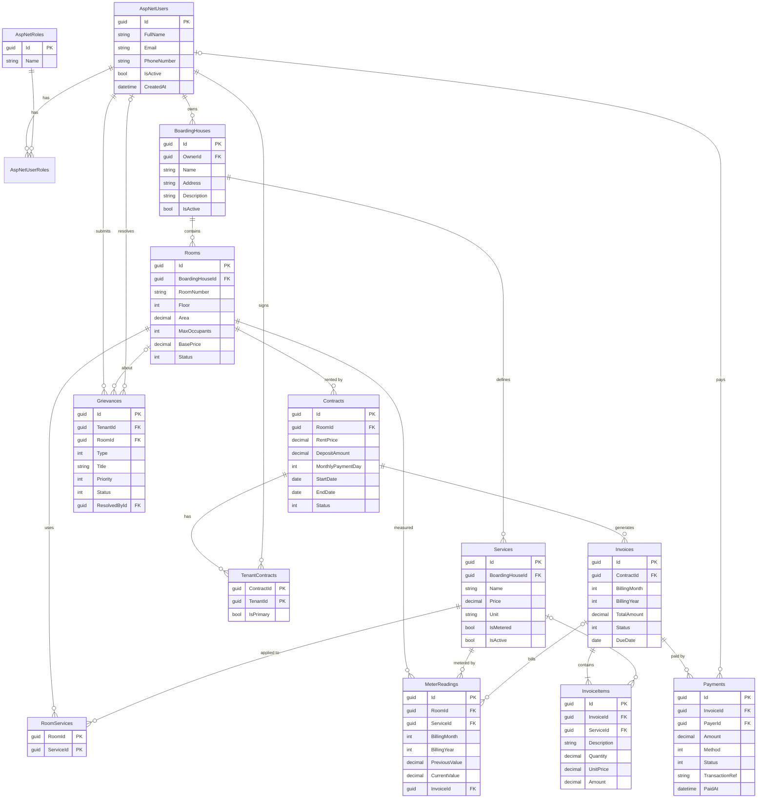

# Dormio (PRN232) — Reduced schema and ERD

Reduced from the original Dormio schema (44 models, 34 enums). The original code is untouched.

## 1. Tables kept (14 tables = 3 Identity + 11 domain)

| # | Table | Source (Prisma) | Notes |
|---|-------|-----------------|-------|
| 1 | AspNetUsers | User (+UserIdentification, BankAccount dropped) | Extends `IdentityUser<Guid>`: FullName, IsActive |
| 2 | AspNetRoles | `UserRole` enum | Roles: Admin, Landlord, Tenant (leasing_agent, employee dropped) |
| 3 | AspNetUserRoles | — | Identity many-to-many |
| 4 | BoardingHouses | BoardingHouse | Address collapsed into one column |
| 5 | Rooms | Room (+RoomType merged) | `UNIQUE(BoardingHouseId, RoomNumber)`, BasePrice added |
| 6 | Services | Service | Electricity/water (metered) and flat fees |
| 7 | RoomServices | RoomService | M:N Room–Service |
| 8 | Contracts | Contract (+Deposit merged) | `DepositAmount` column replaces the Deposit table |
| 9 | TenantContracts | TenantContract | M:N Contract–Tenant, `IsPrimary` |
| 10 | MeterReadings | MeterReading (+History dropped) | `UNIQUE(Room, Service, Month, Year)` |
| 11 | Invoices | Invoice | `UNIQUE(Contract, Month, Year)` |
| 12 | InvoiceItems | InvoiceItem | Rent line has `ServiceId = NULL` |
| 13 | Payments | Payment | payOS/VietQR fields reduced to Method + TransactionRef |
| 14 | Grievances | Grievance (+GrievanceImage dropped) | Complaint / inquiry / feedback workflow |

Dropped for scope: Post/BHRP listing module, Subscription, Chat/AI, Employee/Schedule/Attendance, Notification, Asset, Expense, Otp, AuditLog.

Rules kept: money is `decimal(12,2)`; Invoice/Payment/Contract are never hard-deleted (FK `Restrict`, status transitions only); boarding houses are soft-deleted via `IsActive`.

## 2. ERD

## 3. Use cases kept (mapped to the original spec)

| Actor | Use cases (original UC) |
|-------|-------------------------|
| Landlord | Boarding house CRUD (UC-L-01..), rooms, services, contracts, meter readings, invoices, record payments, handle grievances |
| Tenant | View contract and invoices, pay, submit grievance (UC-T-01..07 subset) |
| Admin | User management, view all grievances (UC-A subset) |

## 4. Architecture

- `src/Dormio.Api` — ASP.NET Core 8 Web API, EF Core 8 (SQL Server), ASP.NET Identity, JWT + role policies, OData (`/odata/Rooms`), Swagger.
- `src/Dormio.Web` — ASP.NET Core MVC, Bootstrap 5, TagHelper (`<status-badge>`), PartialView (`_BoardingHouseCard`), cookie sign-in whose claims/roles come from the API's JWT.
- Implemented vertical slice: Auth (register/login), BoardingHouses (REST CRUD), Rooms (OData read). Remaining modules follow the same pattern.
